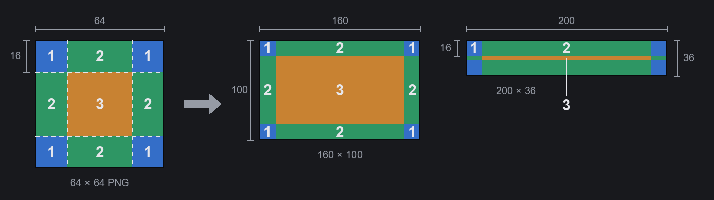

# 3ステップで作る最初のテーマ

Main Button Bar System のテーマ（画面下のメインボタンバーの見た目）を作りたい方向けのガイドです。お絵かきソフトが使えれば作れます。プログラミングも、ツールのインストールも、作業中のゲーム再起動も不要です。

必要なもの：

- Main Button Bar System 1.0 以上。
- PNG を保存できるお絵かきソフト。ペイント、Krita、GIMP、Aseprite、Photoshop などが使えます。半透明を描きたい場合は、透過背景に対応したソフトを選んでください（ペイントは非対応です）。

## ステップ1：空のテーマを作る

1. 設定を開きます。メインメニューまたはゲーム中の「オプション」→「Mod 設定」→「Main Button Bar System」、もしくは「その他」メニューの一番下にある歯車ボタンから開けます。
2. 「外観」タブに切り替え、上で「プリセット」を選び（「カスタム」ではなく）、テーマ一覧の一番下までスクロールして「新規テーマ…」を押します。
3. 「名前」（必須）、「作者」、「説明」を入力します。「Package ID」は自動で作られるので、ふつうは変更不要です。「作成」を押します。

下のバーがすぐに空のテーマに切り替わります。各ボタンは色付きの9スライス枠、バーの背景はグリッド線、ボタンの中央には照準マークが入っています。ファイルはゲームのインストールフォルダの `Mods\<名前>\` に作られ、作成後の画面にフルパスが表示されます。

**設定ウィンドウ下の「保存」を押してください。** 押さずにウィンドウを閉じると、元のテーマに戻ります（ファイルは残っているので、あとでテーマ一覧から選べば大丈夫です）。

## ステップ2：画像を編集する

1. テーマ一覧でこのテーマを選ぶと、カードの下に「再読み込み」「フォルダを開く」「削除」の3つのボタンが出ます。「フォルダを開く」を押します。
2. まず `_Guide_Japanese.png` を開きます。1枚で全体の流れと、各ファイルがバーのどの部分に使われるかがわかります。
3. `Textures` の中にあるフォルダの PNG をお絵かきソフトで編集して保存します。このフォルダは1つだけで、名前は Package ID から作られます（以下 `<Id>` と書きます）。設定ウィンドウで「外観」タブを開き、このテーマを選んでいる間は、約1秒で下のバーが新しい画像に切り替わります。カードの「再読み込み」を押しても反映できます。保存の途中だった場合は、直前の正常な画像がそのまま使われるので、エラーにはなりません。

| ファイル | 描画される場所 | サイズ |
|---|---|---|
| `Button.png` | 通常状態のボタン枠 | 64×64、9スライス |
| `ButtonMouseover.png` | マウスを乗せたとき | 64×64、9スライス |
| `ButtonActive.png` | 押したとき、またはそのタブが開いているとき | 64×64、9スライス |
| `ButtonDisabled.png` | 使えないボタン（マップがないときなど） | 64×64、9スライス |
| `More.png` | 「その他」ボタン | 64×64、9スライス |
| `Drawer.png` | 「その他」を押すと開くメニュー | 64×64、9スライス |
| `Bar.png` | バー全体の背景（横方向にタイル状に繰り返し） | 256×36 |
| `ButtonPicture.png` | 各ボタン枠の下に敷くイラスト | 240×72 |
| `ArrowLeft.png`、`ArrowRight.png` | スクロール用の左右の矢印 | 32×32 |
| `Gear.png` | 「その他」メニュー内の設定ボタン | 64×64 |
| `Preview.png` | 「外観」タブのカードに表示されるプレビュー | 600×36 |
| `About\Preview.png` | Workshop のプレビュー画像 | 640×360 |

空の画像の隅には状態を見分けるための文字が入っています（N 通常、H マウスを乗せた、A 押した、X 使えない、+ その他、W 「その他」メニュー）。自分の絵を描くときは上からそのまま塗りつぶして構いません。

文字色は `Defs\<Id>_Theme.xml` にあります。`labelColor`（通常）、`labelMouseoverColor`（マウスを乗せたとき）、`labelActiveColor`（押したとき）で、`(赤, 緑, 青, 不透明度)` の形式で書きます。各数値は 0～1 で、たとえば `(1, 0.8, 0.4, 1)` は琥珀色です。編集後に保存すれば、こちらも自動で読み込まれます（Mod として有効にする前まで。ステップ3を参照）。

### 9スライスの描き方

ボタン枠、「その他」ボタン、「その他」メニューには、ゲーム本来の9スライス方式が使われています。同じ画像をどんな大きさのボタンにも当てはめられます。

- **画像は正方形にします。** 64×64 がちょうどよいサイズです。正方形でないと、四隅がつぶれてしまいます。
- 画像は9つの領域に分けられます。**四隅**は辺の長さの1/4（64×64 なら 16×16）で、そのままの大きさで描画され、引き伸ばされません（図の1）。**四辺**はボタンの幅または高さに合わせて引き伸ばされます（図の2）。**中央**（32×32）は残りの部分を埋めるように引き伸ばされます（図の3）。
- 引き伸ばしであって、タイル状の繰り返しではありません。辺や中央に置いた模様は伸びます。模様、枠線、角の飾りは、外側の1/4の帯の中に描いてください。
- 下のバーのボタンは高さ36 pxしかないので、上下の辺はそれぞれ16 pxを占めます。枠は細く描き、中央と辺は透明にしておくと、下のイラスト（`ButtonPicture.png`）が見えます。
- 72×72 より大きくしても意味はなく、縮小されるだけです（ボタンの角は最大 18 px）。
- 画面上の向きは PNG と同じです。上は上のままです。

### イラスト（ButtonPicture.png）

240×72 で、各ボタンいっぱいに敷かれ、はみ出した部分は中央を基準に切り取られます。空の画像には、ボタン幅が 120、80、40 px のときに見える範囲が枠で示されています。見せたいものは中央に置いてください。ボタンの文字とアイコンはイラストの上に描かれます。

イラストが不要な場合は、`Defs\<Id>_Theme.xml` の `buttonImage` の部分を削除します。

## ステップ3：仕上げと公開

1. 納得できたら、ゲームの MODリストで有効にして（通常の Mod と同じです）、ゲームを再起動します。以降、「再読み込み」で再読み込みされるのは PNG だけです。Defs を変更した場合は、ゲームを再起動しないと反映されません。
2. `About\About.xml` の名前と説明を書き換え、`About\Preview.png` を差し替えます。
3. アップロード：ゲームの MODリストでそのテーマを選び、ゲーム内蔵のアップロードボタンから Steam Workshop に送ります。アップロード後に Workshop のページを開き、「必要アイテム」（Required items）に Main Button Bar System を追加してください。About.xml に書いた前提 Mod はゲームにしか伝わらず、Steam は知りません。

`_Guide_*.png` と `MBBS_ThemeProject.xml` は残しておいて構いません。ゲームは読み込みません。

このテーマが不要になったら、カードの「削除」を押します。フォルダはセーブデータフォルダの `MainButtonBarSystem\DeletedThemes\` に移動され、元に戻したいときは `Mods` に戻せば復活します。削除できるのは「新規テーマ…」で作ったテーマだけで、MODリストでチェックが外れていて、今回の起動で Mod として読み込まれていないことが条件です（チェックを外したら、一度ゲームを再起動してください）。

## さらに先へ

- **ボタンごとに別の画像を使う**（`buttonImages`）、**バーの端に立ち絵を置くなどの装飾画像**（`decorations`）、**背景全体の画像**：Defs に手動で追加します。書き方は Mod フォルダの `API.md` の第4節（英語）か `API.zh-TW.md`（抜粋）を参照してください。画像はこれまでと同じく `Textures\<Id>\` に置きます。
- **完全なサンプル**：Mod フォルダの `ThemeTemplate\ExampleTheme` にあり、すべてのフィールドを使っています。見比べながら参考にできます。
- **配色ジェネレーター `make_theme.py`**（任意）：JSON で配色を書くと、ボタン枠一式を自動で描き、テーマ Mod 全体を生成します。事前に Python 3 と Pillow のインストールが必要です。
  1. [python.org](https://www.python.org/downloads/) から Python 3 をダウンロードしてインストールします。Windows ではインストール時に「Add python.exe to PATH」にチェックを入れてください。
  2. コマンドプロンプト（macOS、Linux ではターミナル）を開き、`python -m pip install pillow` と入力します（macOS、Linux では `python3`）。
  3. Mod フォルダの `ThemeTemplate\tools` に移動し、`ExampleTheme.json` をコピーして名前を変え、色を編集してから、`python -X utf8 make_theme.py MyTheme.json <出力フォルダ>` を実行します。`ExampleTheme.json` にはすべての設定が使われています。各設定の意味は `make_theme.py` の冒頭に中国語（繁体字）で書かれています。
