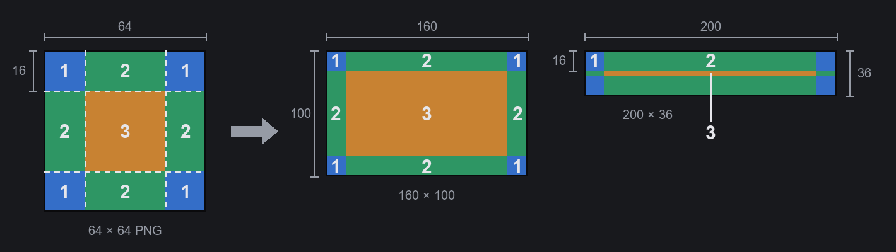

# Your first theme in three steps

For anyone who wants to make a theme (the look of the main button bar at the bottom of the screen) for Main Button
Bar System. If you can use an image editor you can make one: no programming, no tools to install, and no restart
while you work.

You need:

- Main Button Bar System 1.0 or later.
- An image editor that saves PNG: Paint, Krita, GIMP, Aseprite, Photoshop… For see-through parts, pick one that
  supports transparency (Paint does not).

## Step 1: make a blank theme

1. Open the settings: **Options** → **Mod Settings** → **Main Button Bar System**, from the main menu or in a game,
   or click the gear at the bottom of the **More** drawer.
2. Go to the **Appearance** tab, choose **Preset themes** at the top (not **Custom theme**), scroll to the end of the
   theme list and click **New theme…**.
3. Fill in **Name** (required), **Author** and **Description**. The **Package ID** is made for you; you rarely need
   to change it. Click **Create**.

The bar switches to the blank theme at once: every button is a tinted nine-slice frame, the bar has a grid behind
it, and there is a crosshair in the middle of each button. The files are in `Mods\<Name>\` in the game's install
folder; the full path is shown when the theme is made.

**Click Save at the bottom of the settings window** to keep the new theme selected. If you close the window without
saving, the bar goes back to your old theme (the files stay; pick the theme in the list again later).

## Step 2: edit the images

1. Select the theme in the list: **Reload**, **Open folder** and **Delete** appear under its card. Click
   **Open folder**.
2. Open `_Guide_English.png` first: one picture with the whole process and which file paints which part of the bar.
3. Edit the PNGs in the folder inside `Textures` with your image editor and save. There is only one folder there;
   its name comes from the Package ID and is written `<Id>` below. While the settings window shows the
   **Appearance** tab with this theme selected, the bar
   picks up the new image within about a second; **Reload** on the card does it at once. A file that is still being
   saved keeps the last good image, so nothing breaks.

| File | Paints | Size |
|---|---|---|
| `Button.png` | A button's frame, normal | 64×64, nine-slice |
| `ButtonMouseover.png` | Under the mouse | 64×64, nine-slice |
| `ButtonActive.png` | Pressed, or its tab is open | 64×64, nine-slice |
| `ButtonDisabled.png` | A button that cannot be used (no map, for example) | 64×64, nine-slice |
| `More.png` | The **More** button | 64×64, nine-slice |
| `Drawer.png` | The drawer that **More** opens | 64×64, nine-slice |
| `Bar.png` | Behind the whole bar, repeated across | 256×36 |
| `ButtonPicture.png` | The picture inside every button, under its frame | 240×72 |
| `ArrowLeft.png`, `ArrowRight.png` | The scroll arrows | 32×32 |
| `Gear.png` | The drawer's settings button | 64×64 |
| `Preview.png` | The preview on the card in the **Appearance** tab | 600×36 |
| `About\Preview.png` | The Workshop preview | 640×360 |

The blank images have a letter in a corner to tell the states apart (N normal, H under the mouse, A pressed,
X disabled, + More, W drawer); just paint over it.

Label colours are in `Defs\<Id>_Theme.xml`: `labelColor` (normal), `labelMouseoverColor` (under the mouse) and
`labelActiveColor` (pressed), written `(red, green, blue, opacity)` with each number from 0 to 1;
`(1, 0.8, 0.4, 1)` is amber. Saving that file is picked up the same way (until you enable the theme as a mod, see step 3).

### Drawing a nine-slice image

Button frames, **More** and the drawer use the game's own nine-slice method, so one image fits a button of any size:

- **The image must be square**; 64×64 is right. If it is not square, the corners get squashed.
- It is cut into nine parts. The **four corners** are each a quarter of the side (16×16 in a 64×64 image) and are
  drawn as they are, never stretched (1 in the picture). The **four edges** stretch along the button's length or
  height (2). The **middle** (32×32) stretches over the rest (3).
- Parts are stretched, not repeated: a pattern on an edge or in the middle gets pulled long. Keep patterns, borders
  and corner art in the outer quarter.
- Bar buttons are only 36 pixels tall, so the top and bottom edges take 16 pixels each. Draw the frame thin and keep
  the edges and middle see-through if the picture under it (`ButtonPicture.png`) should show.
- Larger than 72×72 does not help; it is only scaled down (a button's corners are at most 18 pixels).
- The image is drawn the way it looks in the PNG: top is top.

### The picture inside the buttons (ButtonPicture.png)

240×72. It fills every button, centred, and the parts that do not fit are cut off. The blank picture marks what is
still visible on buttons 120, 80 and 40 pixels wide: keep the important part in the middle. The button's label and
icon are drawn on top of it.

To have no picture, delete the `buttonImage` block from `Defs\<Id>_Theme.xml`.

## Step 3: finish and share

1. When you are happy with it, enable it in the game's mod list like any other mod and restart. From then on
   **Reload** only reads the PNGs again; changes to Defs need a restart.
2. Change the name and description in `About\About.xml` and replace `About\Preview.png`.
3. Upload: select it in the game's mod list and use the game's own upload button for the Steam Workshop. Then, on the
   Workshop page, add Main Button Bar System under **Required items**: the dependency in About.xml is only seen by
   the game, not by Steam.

`_Guide_*.png` and `MBBS_ThemeProject.xml` can stay; the game does not read them.

Don't want the theme any more? **Delete** on the card moves the folder to `MainButtonBarSystem\DeletedThemes\` in
the game's save data folder; move it back into `Mods` to restore it. Only themes made with **New theme…** can be
deleted, and only while they are not ticked in the mod list and the game did not load them as a mod this session
(after unticking, restart the game once).

## Going further

- **A different picture per button** (`buttonImages`), **decorations such as a portrait at a corner of the bar**
  (`decorations`), **a whole-image background**: add them to the Defs by hand, see section 4 of `API.md` in the mod
  folder. Their images go in `Textures\<Id>\` too.
- **A complete example**: `ThemeTemplate\ExampleTheme` in the mod folder uses every field.
- **The palette generator `make_theme.py`** (optional): write a colour palette in JSON and it draws the whole set of
  frames and writes a complete theme mod. It needs Python 3 and Pillow:
  1. Install Python 3 from [python.org](https://www.python.org/downloads/). On Windows, tick "Add python.exe to
     PATH" in the installer.
  2. Open a command prompt (a terminal on macOS or Linux) and run `python -m pip install pillow` (`python3` on macOS
     and Linux).
  3. In the mod folder's `ThemeTemplate\tools`, copy `ExampleTheme.json`, rename it, change the colours, and run
     `python -X utf8 make_theme.py MyTheme.json <output folder>`. `ExampleTheme.json` uses every setting; what
     each one means is written (in Chinese) at the top of `make_theme.py`.
