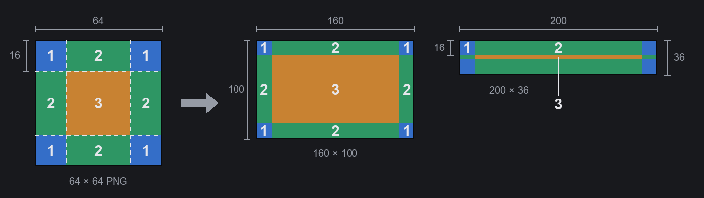

# 三步做出第一个主题

写给想为 Main Button Bar System 做主题（底部主按钮栏的外观）的人。只要会用绘图软件就行：不用写代码、不用装工具、制作过程中不用重启游戏。

需要的东西：

- Main Button Bar System 1.0 以上。
- 能保存 PNG 的绘图软件，画图、Krita、GIMP、Aseprite、Photoshop 都可以。要画半透明的话，请选支持透明背景的软件（画图不行）。

## 第一步：创建空白主题

1. 打开设置：主菜单或游戏中的“选项”→“Mod 设置”→“Main Button Bar System”，或点“更多”抽屉最下面的齿轮。
2. 切到“外观”标签页，上方选“预设主题”（不是“自定义主题”），把主题列表拉到最后，点“新建主题…”。
3. 填写“名称”（必填）、“作者”、“说明”。“Package ID”会自动生成，通常不用改。点“创建”。

底部栏会马上换成这个空白主题：每个按钮是上了色的九宫格框，栏的背景是网格线，按钮中间有一个准星。文件创建在游戏安装文件夹的 `Mods\<名称>\` 里，创建完成后界面会显示完整路径。

**记得点设置窗口下面的“保存”**，新主题才会一直保持选中。没保存就关掉窗口，会回到原来的主题（文件还在，之后在主题列表里选它就行）。

## 第二步：改图

1. 在主题列表里选中这个主题，卡片下面会出现“重新加载”“打开文件夹”“删除”三个按钮。点“打开文件夹”。
2. 先打开 `_Guide_ChineseSimplified.png`：一张图看懂整个流程，也标出了每个文件画的是底部栏的哪一块。
3. 用绘图软件修改 `Textures` 里那个文件夹中的 PNG，然后保存。那个文件夹只有一个，名称由 Package ID 生成，下面写成 `<Id>`。设置窗口停在“外观”标签页、并且选中这个主题的时候，大约一秒内底部栏就会换成新的图；也可以点卡片上的“重新加载”。文件还没保存完时，会先保留上一张正常的图，不会出错。

| 文件 | 画在哪里 | 尺寸 |
|---|---|---|
| `Button.png` | 普通状态的按钮框 | 64×64，九宫格 |
| `ButtonMouseover.png` | 鼠标移上去 | 64×64，九宫格 |
| `ButtonActive.png` | 按下去，或该标签页开着 | 64×64，九宫格 |
| `ButtonDisabled.png` | 不能用的按钮（例如没有地图时） | 64×64，九宫格 |
| `More.png` | “更多”按钮 | 64×64，九宫格 |
| `Drawer.png` | 点“更多”打开的抽屉 | 64×64，九宫格 |
| `Bar.png` | 整条栏的背景，横向重复铺满 | 256×36 |
| `ButtonPicture.png` | 每个按钮框底下的插图 | 240×72 |
| `ArrowLeft.png`、`ArrowRight.png` | 滚动用的左右箭头 | 32×32 |
| `Gear.png` | 抽屉里的设置按钮 | 64×64 |
| `Preview.png` | “外观”标签页卡片上的预览 | 600×36 |
| `About\Preview.png` | 创意工坊的预览图 | 640×360 |

空白图的角落有一个字母，用来区分状态（N 普通、H 鼠标移上去、A 按下、X 不能用、+ 更多、W 抽屉），画自己的图时直接盖掉就行。

文字颜色在 `Defs\<Id>_Theme.xml`：`labelColor`（普通）、`labelMouseoverColor`（鼠标移上去）、`labelActiveColor`（按下），写法是 `(红, 绿, 蓝, 不透明度)`，每个数字 0～1，例如 `(1, 0.8, 0.4, 1)` 是琥珀色。改完保存同样会自动读取（启用成模组之前，见第三步）。

### 九宫格怎么画

按钮框、“更多”、抽屉用的是游戏原本的九宫格画法，同一张图可以套用在任何大小的按钮上：

- **图要是正方形**，64×64 刚好。不是正方形的话，四个角会被压扁。
- 图被切成九块：**四个角**各是边长的 1/4（64×64 就是 16×16），按原样绘制，不会拉伸（图中 1）。**四条边**沿着按钮的长或高拉伸（图中 2）。**中间**（32×32）拉伸填满剩下的地方（图中 3）。
- 是拉伸，不是重复铺：放在边或中间的花纹会被拉长。花纹、边框、角饰都画在外侧那 1/4 圈里。
- 底部栏的按钮只有 36 px 高，上下两条边各占 16 px。框要画细，中间和边留透明，下面的插图（`ButtonPicture.png`）才看得到。
- 比 72×72 大没有用，只会被缩小（按钮的角最多 18 px）。
- 画面上的方向和 PNG 一样，上面就是上面。

### 插图（ButtonPicture.png）

240×72，会铺满每个按钮，多出来的部分裁掉（居中）。空白图上用框标出了按钮宽 120、80、40 px 时还能看到的范围：重点要放在中间。按钮的文字和图标画在插图上面。

不想要插图的话，删掉 `Defs\<Id>_Theme.xml` 里 `buttonImage` 那一段。

## 第三步：完成、分享

1. 满意之后，到游戏的 模组列表里启用它（和普通模组一样），然后重启游戏。之后“重新加载”只会重读 PNG，改了 Defs 要重启游戏才会生效。
2. 修改 `About\About.xml` 里的名称和说明，换掉 `About\Preview.png`。
3. 上传：在游戏的 模组列表里选中它，用游戏内置的上传按钮传到 Steam 创意工坊。上传完到创意工坊页面，在“必要项目”（Required items）里加上 Main Button Bar System。About.xml 里写的前置只有游戏看得到，Steam 不知道。

`_Guide_*.png` 和 `MBBS_ThemeProject.xml` 可以留着，游戏不会读。

不想要这个主题了：点卡片上的“删除”，文件夹会被移到存档文件夹的 `MainButtonBarSystem\DeletedThemes\`，想找回就把它移回 `Mods`。只能删除通过“新建主题”做出来的主题，而且要在 模组列表里没有勾选、这次启动游戏也没有被当成模组加载（取消勾选后要先重启一次游戏）。

## 再进一步

- **每个按钮放不同的图**（`buttonImages`）、**栏角的立绘这类装饰图**（`decorations`）、**整张背景图**：在 Defs 里手动添加，写法见模组文件夹里的 `API.md` 第 4 节（英文）或 `API.zh-CN.md`（节选）。图同样放在 `Textures\<Id>\`。
- **完整示例**：模组文件夹里的 `ThemeTemplate\ExampleTheme`，用到了所有字段，可以对照着看。
- **配色生成器 `make_theme.py`**（可选）：写一份 JSON 配色，自动画出整套按钮框，生成整个主题模组。需要先安装 Python 3 和 Pillow：
  1. 到 [python.org](https://www.python.org/downloads/) 下载安装 Python 3。Windows 安装时勾选“Add python.exe to PATH”。
  2. 打开命令提示符（macOS、Linux 用终端），输入 `python -m pip install pillow`（macOS、Linux 用 `python3`）。
  3. 到模组文件夹的 `ThemeTemplate\tools`，复制 `ExampleTheme.json` 并改名、改颜色，再执行 `python -X utf8 make_theme.py MyTheme.json <输出文件夹>`。`ExampleTheme.json` 用到了所有设置，每个设置的含义写在 `make_theme.py` 开头的说明里（繁体中文）。
