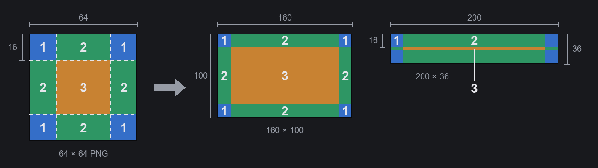

# 三步做出第一個主題

給想替 Main Button Bar System 做主題（底部主按鈕列的外觀）的人。只要會用繪圖軟體就能做：不用寫程式、不用裝工具、做的過程中不用重開遊戲。

需要的東西：

- Main Button Bar System 1.0 以上。
- 能存 PNG 的繪圖軟體，小畫家、Krita、GIMP、Aseprite、Photoshop 都可以。要畫半透明的話，選支援透明背景的軟體（小畫家不行）。

## 第一步：建立空白主題

1. 打開設定：主選單或遊戲中的「選項」→「模組設定」→「Main Button Bar System」，或點「更多」抽屜最下面的齒輪。
2. 切到「外觀」分頁，上方選「預設主題」（不是「自訂主題」），主題清單拉到最後，按「新增主題…」。
3. 填「名稱」（必填）、「作者」、「說明」。「Package ID」會自動產生，通常不用改。按「建立」。

底部列馬上換成這個空白主題：每顆按鈕是上了色的九宮格框，列的背景是格線，按鈕中間有一個準心。檔案建立在遊戲安裝資料夾的 `Mods\<名稱>\`，建立完畫面會寫出完整路徑。

**記得按設定視窗下面的「儲存」**，新主題才會一直選著。沒儲存就關掉視窗，會回到原本的主題（檔案還在，之後在主題清單選它就好）。

## 第二步：改圖

1. 在主題清單選這個主題，卡片下面會出現「重新載入」「開啟資料夾」「刪除」三個按鈕。按「開啟資料夾」。
2. 先打開 `_Guide_ChineseTraditional.png`：一張圖看懂整個流程，也標出每個檔案畫的是底部列的哪一塊。
3. 用繪圖軟體改 `Textures` 裡那個資料夾的 PNG，存檔。那個資料夾只有一個，名稱由 Package ID 產生，下面寫成 `<Id>`。設定視窗開在「外觀」分頁、而且選著這個主題的時候，大約一秒內底部列就會換成新的圖；也可以按卡片上的「重新載入」。檔案還沒存完時會先保留上一張正常的圖，不會出錯。

| 檔案 | 畫在哪裡 | 尺寸 |
|---|---|---|
| `Button.png` | 一般狀態的按鈕框 | 64×64，九宮格 |
| `ButtonMouseover.png` | 滑鼠移上去 | 64×64，九宮格 |
| `ButtonActive.png` | 按下去，或那個分頁開著 | 64×64，九宮格 |
| `ButtonDisabled.png` | 不能用的按鈕（例如沒有地圖時） | 64×64，九宮格 |
| `More.png` | 「更多」按鈕 | 64×64，九宮格 |
| `Drawer.png` | 按「更多」打開的抽屜 | 64×64，九宮格 |
| `Bar.png` | 整條列的背景，橫向重複鋪滿 | 256×36 |
| `ButtonPicture.png` | 每顆按鈕框底下的插圖 | 240×72 |
| `ArrowLeft.png`、`ArrowRight.png` | 捲動用的左右箭頭 | 32×32 |
| `Gear.png` | 抽屜裡的設定按鈕 | 64×64 |
| `Preview.png` | 「外觀」分頁卡片上的預覽 | 600×36 |
| `About\Preview.png` | 工作坊的預覽圖 | 640×360 |

空白圖的角落有一個字母，用來分辨狀態（N 一般、H 滑鼠移上去、A 按下、X 不能用、+ 更多、W 抽屜），畫自己的圖時直接蓋掉就好。

文字顏色在 `Defs\<Id>_Theme.xml`：`labelColor`（一般）、`labelMouseoverColor`（滑鼠移上去）、`labelActiveColor`（按下），寫法是 `(紅, 綠, 藍, 不透明度)`，每個數字 0～1，例如 `(1, 0.8, 0.4, 1)` 是琥珀色。改完存檔一樣會自動讀取（啟用成模組之前，見第三步）。

### 九宮格怎麼畫

按鈕框、「更多」、抽屜用的是遊戲原本的九宮格畫法，同一張圖能套在任何大小的按鈕上：

- **圖要是正方形**，64×64 剛好。不是正方形的話，四個角會被壓扁。
- 圖切成九塊：**四個角**各是邊長的 1/4（64×64 就是 16×16），照原樣畫，不會拉伸（圖中 1）。**四條邊**沿著按鈕的長或高拉伸（圖中 2）。**中間**（32×32）拉伸填滿剩下的地方（圖中 3）。
- 是拉伸，不是重複鋪：放在邊或中間的花紋會被拉長。花紋、邊框、角飾都畫在外側那 1/4 圈裡。
- 底部列的按鈕只有 36 px 高，上下兩條邊就各佔 16 px。框要畫細，中間和邊留透明，下面的插圖（`ButtonPicture.png`）才看得到。
- 比 72×72 大沒有用，只會被縮小（按鈕的角最多 18 px）。
- 畫面上的方向和 PNG 一樣，上面就是上面。

### 插圖（ButtonPicture.png）

240×72，會鋪滿每顆按鈕、多出來的部分裁掉（置中）。空白圖上用框標出按鈕寬 120、80、40 px 時還看得到的範圍：重點要放在中間。按鈕的文字和圖示畫在插圖上面。

不想要插圖的話，刪掉 `Defs\<Id>_Theme.xml` 裡 `buttonImage` 那一段。

## 第三步：完成、分享

1. 滿意之後，到遊戲的模組清單啟用它（和一般模組一樣），重開遊戲。之後「重新載入」只會重讀 PNG，改了 Defs 要重開遊戲才會生效。
2. 改 `About\About.xml` 裡的名稱和說明，換掉 `About\Preview.png`。
3. 上傳：在遊戲的模組清單選它，用遊戲內建的上傳按鈕傳到 Steam 工作坊。上傳完到工作坊頁面，在「必要項目」（Required items）加上 Main Button Bar System。About.xml 裡寫的前置只有遊戲看得到，Steam 不知道。

`_Guide_*.png` 和 `MBBS_ThemeProject.xml` 可以留著，遊戲不會讀。

不要這個主題了：按卡片上的「刪除」，資料夾會搬到存檔資料夾的 `MainButtonBarSystem\DeletedThemes\`，要找回就搬回 `Mods`。只能刪「新增主題」做出來的主題，而且要在模組清單沒勾選、這次開遊戲也沒被當成模組載入（取消勾選後要先重開一次遊戲）。

## 再進一步

- **每顆按鈕放不同的圖**（`buttonImages`）、**列角的立繪這類裝飾圖**（`decorations`）、**整張背景圖**：在 Defs 裡手動加，寫法見模組資料夾的 `API.md` 第 4 節（英文）或 `API.zh-TW.md`（節錄）。圖一樣放在 `Textures\<Id>\`。
- **完整範例**：模組資料夾的 `ThemeTemplate\ExampleTheme`，用到所有欄位，可以對照著看。
- **配色產生器 `make_theme.py`**（選用）：寫一份 JSON 配色，自動畫出整套按鈕框，產生整個主題模組。要先裝 Python 3 和 Pillow：
  1. 到 [python.org](https://www.python.org/downloads/) 下載安裝 Python 3。Windows 安裝時勾「Add python.exe to PATH」。
  2. 打開命令提示字元（macOS、Linux 用終端機），輸入 `python -m pip install pillow`（macOS、Linux 用 `python3`）。
  3. 到模組資料夾的 `ThemeTemplate\tools`，複製 `ExampleTheme.json` 改名、改顏色，再執行 `python -X utf8 make_theme.py MyTheme.json <輸出資料夾>`。`ExampleTheme.json` 用到了所有設定，每個設定的意思寫在 `make_theme.py` 開頭的說明。
