# 補測：round-8、round-9、theme-addons、round-10 B.3／B.4 實機測試結果

- 版本：main @ `36d9333`（PR #19 合併後）。`Mods\MainButtonBarSystem` 由 `deploy.ps1` 部署，`DEPLOYED_FROM.txt` 是 main @ `36d9333`，用 repo 裡的 DLL
- 測試日期：2026-11-06 17:40～19:10（Claude 用 computer use 操作，本機）
- 遊戲：RimWorld 1.7.5000 rev1275，2560×1440 全螢幕、介面縮放 1.25，開發模式開（D3、D6 那一段關掉），介面簡中（A4 切繁中、round-9 E2 切日文）
- `Mods\ExampleTheme` 從 repo `docs/examples/ExampleTheme` 複製；各段要改的 Def／貼圖寫在該段，每段開始前先還原成 repo 原樣（比對雜湊）
- 這次補的清單：`theme-addons.md` 還沒測的項目（A、B、C、D、E、G、H2、H4～H7、H9、H10、H12～H14；H1、H3、H8、H11、F 之前已測）、`round-8.md` 1～8、`round-9.md` A～E、`round-10.md` B.3、B.4（E.3 沒有 DragReorder，跳過）

## 總結

| 清單 | 結果 | 說明 |
|---|---|---|
| theme-addons A 載入 | ✅ | A2 的警告數是 1（萘伊的 `buttonImages` 有按鈕沒載入），見「清單要更新的地方」 |
| theme-addons B 外部主題外觀 | ✅ | B1～B6 全部符合 |
| theme-addons C 玩家可調的值 | ✅ | C1～C8 全部符合 |
| theme-addons D 檢查與重載 | ✅ | D1～D6 全部符合，警告原文見 D 節 |
| theme-addons E 舊主題與舊存檔 | ✅ | |
| theme-addons G 工具與範本 | ✅ | G1 位元組不同、像素相同（Pillow 版本），見 G 節 |
| theme-addons H 按鈕圖 | ✅ | H9 只驗了一半（同一輪拿掉了預設圖），H12 在預設寬度下 Fit 和 Stretch 看不出差別，拉寬後確認 |
| round-8 1～8 | ✅ | 步驟 1 的「改回預設」和 VTE 的設定有關；M 節 M4 沒測、M8 不符但不是本模組的問題，見 round-8 節 |
| round-9 A～E | ✅ | C4（上傳工作坊）選做沒做；D3 只做靜態檢查 |
| round-10 B.3 | ⚠️ | 畫的時候丟例外的按鈕記了兩筆紅字（being drawn 一筆、handling input 一筆），清單預期只有一筆 |
| round-10 B.4 | ✅ | |
| round-10 E.3 | — | 沒有 DragReorder，跳過 |

新發現的問題整理在最後的「發現的問題」。

## 實機測試的環境

排序都在 `RimCrow\backups\other\`，用 RimCrow 匯入，`modsconfig_check.py` 每次都是 `same order: True`。底是 Lost Forest 測試排序裡的優化／讀取優化模組（拿掉【ZP】Rice 和 Lost Forest），加 `selftest_cleanlog` 那份的主按鈕模組和本模組。

| 用途 | 排序 | 模組數 |
|---|---|---|
| S1：A、B、C、E、H4、H10、round-8 1／3／4／5、round-9 A、C1～C2、E1 | `ModsConfig_20261106_1741_mbbs_r89a_main.xml`（上面那個底＋VTE＋ExampleTheme） | 51 |
| RA：D1、D2、H7、H13、H14、round-9 C3、round-10 B.3 | `..._1815_mbbs_r89a_RA.xml`：main＋「做成排序模組」做出來的模組＋測試用丟例外按鈕模組 | 53 |
| RB：D3、D6（開發模式關） | 同 RA | 53 |
| RC：A4（繁中）、H2、H5、H6、H9、H12 Fit、C1 | main | 51 |
| RD：H12 Stretch、round-9 E2（日文） | main | 51 |
| RE：round-10 B.4 | `..._1833_mbbs_r89a_RE.xml`：main＋拿掉 Tuning `behaviour` 的補丁模組 | 52 |
| RF：round-8 6 | `..._1836_mbbs_r89a_RF.xml`：main＋Custom Bottom Bar | 52 |
| M1～M3：round-8 7、round-9 B1／B3～B5 | `..._1842_mbbs_r89a_M_{buttons_max,retexture,retexture_swap}_noroe_noai.xml` | 74／78／78 |
| RG：round-8 2、round-9 B2、D1 | `..._1852_mbbs_r89a_RG.xml`：main 拿掉 VTE，加兩個範例模組 | 52 |
| RH：round-9 D2 | `..._1857_mbbs_r89a_RH.xml`：main 拿掉本模組和 ExampleTheme，加 SoftRace 範例 | 50 |
| G4 | main，`Mods\MainButtonBarSystem` 暫時換成 `make_release.py` 的輸出 | 51 |

- M 節三份是 `ModsConfig_20261104_1309_mbbs_*_noroe.xml` 再拿掉 RimTalk 系列 6 個（`cj.rimtalk`、`cj.rimtalk.expandmemory` 等）：測試排序不能放會用 API 金鑰呼叫 AI 的模組。M4（RimTalkDebug 的圖示來源）因此沒測。
- check_order：每份都只剩已知的 `0multiplayerapi.dll` 同名 DLL。xml_check：ExampleTheme、兩個範例模組、排序模組、兩個測試用小模組 0 問題。
- 測試用小模組（`local.mbbs.r10throw`、`local.mbbs.r10nobehaviour`）的原始碼在本機測試資料夾 `round-8-9-addons\test_mods\`，不在 repo，測完已從 `Mods\` 移走。
- 存檔：S1 開發快速測試開新局，存成 `MBBS_r89a_test`，之後各段都讀它。E3 讀第七輪的 `MBBS_round7_test`。
- log：本機測試資料夾 `round-8-9-addons\logs\`，每段一個資料夾（`S1_main`、`RA_…`、`RB_…`、…、`G4_release_folder`）。

## theme-addons

### A. 載入

- A1 ✅ 主選單沒有本模組或 ExampleTheme 的紅字，log 有 `[Main Button Bar System] Loaded.`。
- A2 ✅（數字不同）`Themes: 8 theme(s), 1 warning(s)`。那一個警告是萘伊：`Theme MBBS_Nai (…), buttonImages: 53 picture(s) name main buttons that are not loaded …`，小排序本來就會有（round-12-fixes 之後每款主題合併成一條）。ExampleTheme 0 警告。
- A3 ✅ 卡片順序：原版、帝國、信條、基因實驗室、虛空、星航、萘伊、示例鋼鐵（最後）。Example 的作者行「Your name（Example Theme for Main Button Bar System）」，預覽是它自己的 Preview 圖。

  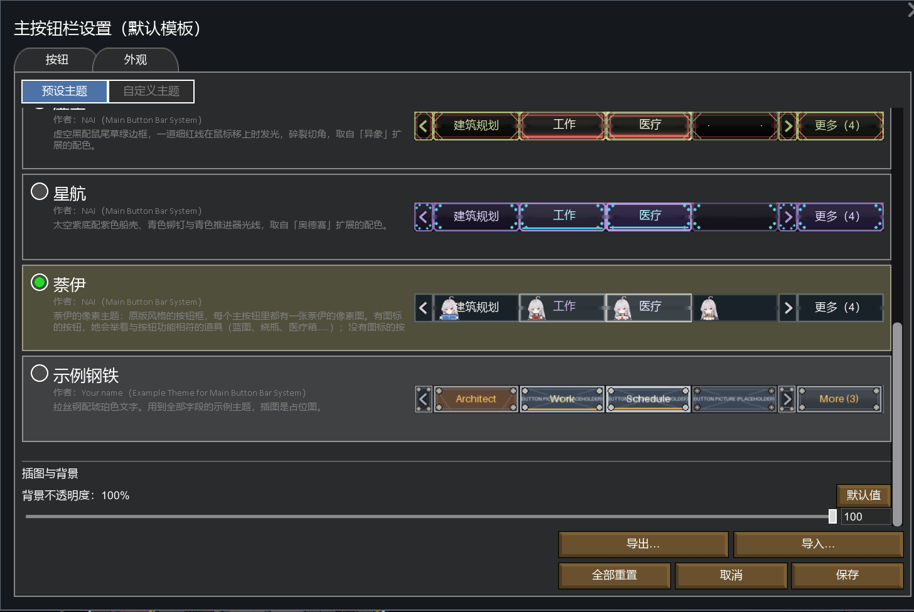

- A4 ✅ 繁中（RC）：Example 卡片「範例鋼鐵」、說明「拉絲鋼配琥珀色文字。用到全部欄位的範例主題，插圖是佔位圖。」，萘伊卡片「萘伊」。換回簡中（RG 之後）再開設定視窗，卡片正常。1.7 換語言會重開遊戲，所以沒有「同一場 play data reload」的情況可以測。

  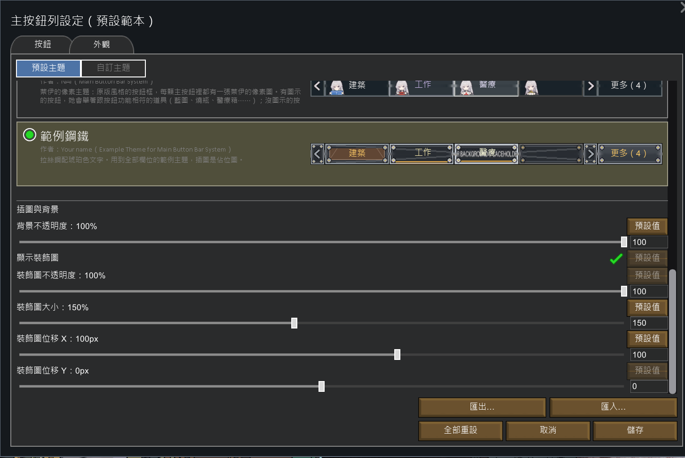

### B. 外部主題的外觀（S1）

- B1 ✅ 底部列背景是一整張拉伸圖：把按鈕預設寬度縮到 70、關掉填滿畫面後，列右半露出背景，佔位圖的對角線被拉成接近水平的長線、「BAR BACKGROUND (PLACEHOLDER)」字樣橫跨整條列，不是九宮格。

  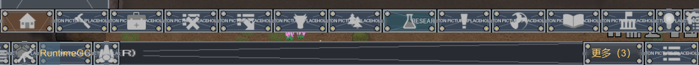

- B2 ✅ 左下角立繪 160×240（量到 240×360 UI px 是 150% 範本值時；100% 時 160×240），底邊貼齊螢幕底，按鈕畫在它上面。
- B3 ✅ 滑鼠移到列上（空白處）右端出現 HOVER（48×48）；移到立繪長出列外的部分不出現；離開列就消失。

  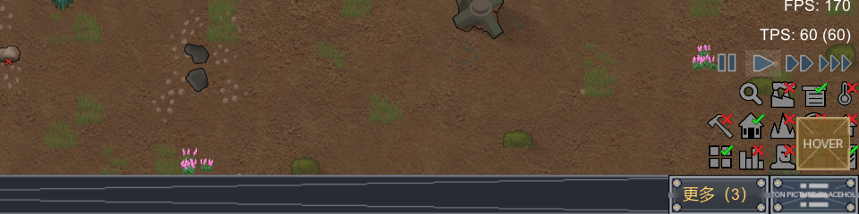
  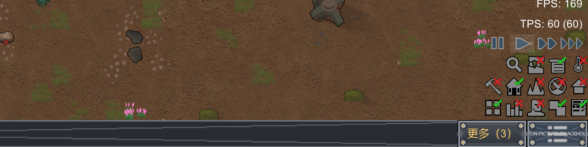

- B4 ✅ 摺疊模式打開抽屜：HOVER 持續顯示；抽屜右上角 DRAWER（64×64）蓋在格子和齒輪上面；抽屜背景是九宮格。

  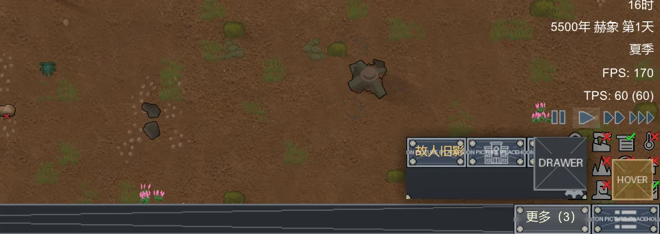

- B5 ✅ 文字顏色（取文字最亮的像素平均）：一般 (245,202,116)≈(1,0.8,0.45)、滑鼠移上 (255,242,179)≈(1,0.95,0.7)、「工作」分頁開著 (255,255,217)≈(1,1,0.85)。

  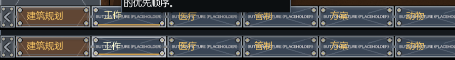

- B6 ✅ 捲動模式的箭頭是 ExampleTheme 的貼圖；捲動後立繪位置不變。

### C. 玩家可調的值

- C1 ✅（RC，H2 拿掉預設按鈕圖之後才看得到列背景）背景不透明度 30%：按鈕框內透出的列背景變暗（例：計畫鈕內部平均 48→35、BACKGROUND 字樣處 67→45，夜晚地圖）；外觀分頁 Example 卡片的預覽不變（還是 100%）。按「預設值」回 100%。

  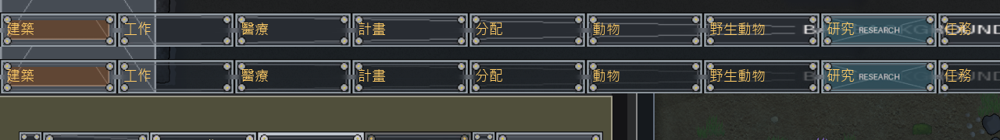

- C2 ✅ 關掉「顯示裝飾圖」立繪消失、開回來出現；「預設值」只在改過後可按。
- C3 ✅ 裝飾圖不透明度 50%：立繪半透明。
- C4 ✅ 200%：立繪 320×480 UI px、左下角不動；50%：80×120。

  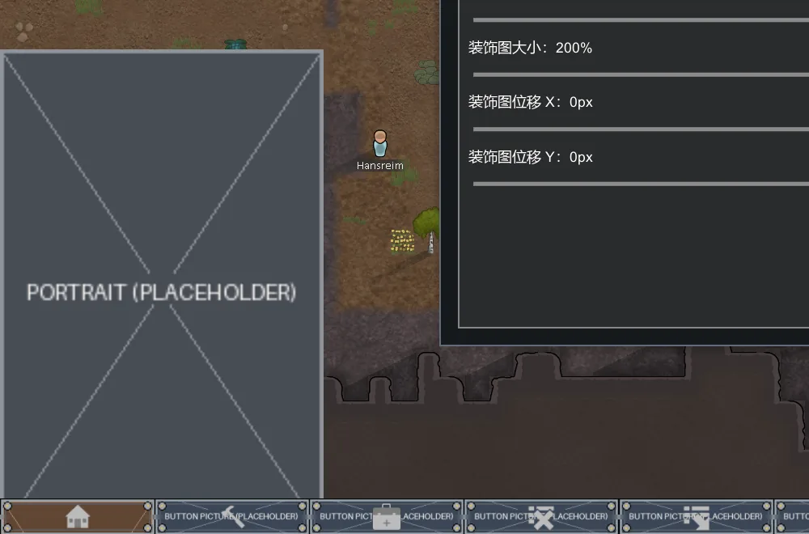

- C5 ✅ 位移 X 100、Y −50：立繪往右 100、往上 50（50% 時量到左邊 100 px、底邊離螢幕底 50 px）；數字框直接打 `-50` 可以。

  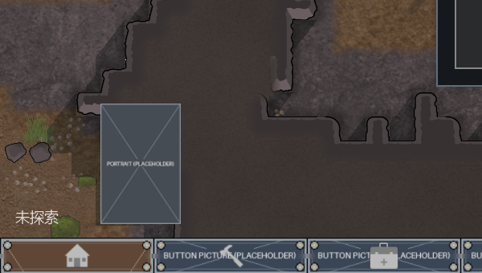

- C6 ✅ 各項「預設值」都回到預設；「全部重設」有確認視窗，確定後這一節和主題一起回到預設（變原版、「插圖與背景」只剩灰字）。
- C7 ✅ 改滑桿時列即時變化；按「取消」後回到存檔的值。
- C8 ✅ 主選單把範本設成示例鋼鐵、裝飾大小 150、位移 X 100 並儲存，開發快速測試開新局：立繪是 240×360、左邊 100 px，套用了範本。

  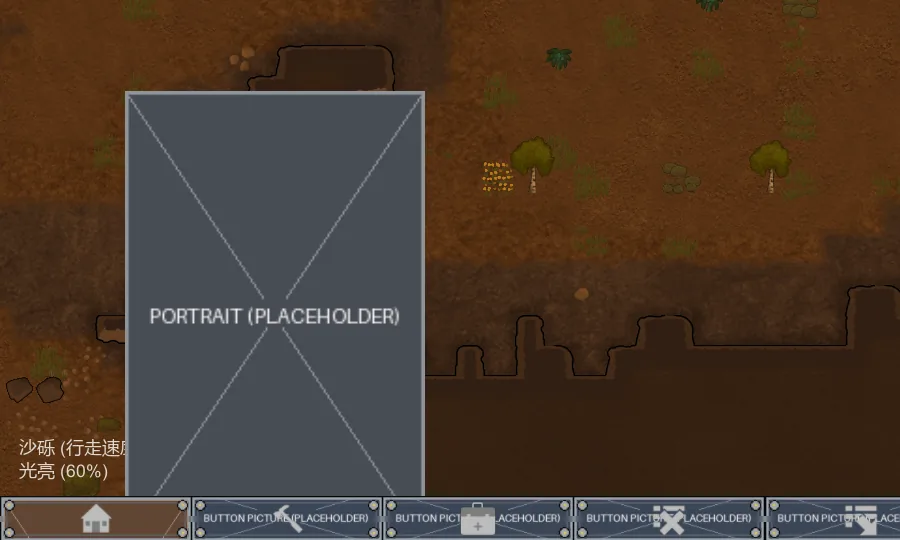

### D. 開發者模式的檢查與重載

D1、D2 和 H7、H13、H14 在同一次重開（RA）一起改：`HoverBadge.png`、`ButtonResearch.png` 改名，`Button.png` 換成 64×48，Defs 的 `buttonImages` 加三項（沒寫 `button`、`button` 是 `Achitect`、`History` 的 `opacity` 寫 2）。所以這次的 Themes 那行是 `8 theme(s), 5 warning(s)`（萘伊 1＋ExampleTheme 4）。

- D1 ✅ 主選單黃字：`[Main Button Bar System] Theme ExampleTheme_Steel (Example Theme for Main Button Bar System), decorations[1].texture: texture 'ExampleTheme/HoverBadge' not found (the game's look is used for it)`。進地圖、滑鼠移上列、打開抽屜之後沒有再多記 `using the game's look`；HOVER 不顯示，其他裝飾正常，沒有紅字。
- D2 ✅ `… button: atlas 'ExampleTheme/Button' is 64x48, not square: its corners will be squashed`。
- D3 ✅（RB，開發模式關）主選單沒有帶欄位名的主題檢查黃字；進地圖、滑鼠移上列後只有一筆 `[Main Button Bar System] Theme ExampleTheme_Steel: texture 'ExampleTheme/HoverBadge' not found; using the game's look for it.`，之後來回移上幾次都沒有再記（另有一筆同樣格式的 `ButtonResearch`）。
- D4 ✅ `Portrait.png` 整張塗紅後按「重新載入主題貼圖」：立繪立刻變紅，左上訊息「主题贴图已重新加载：重新读取了 116 个文件。」，沒有紅字。

  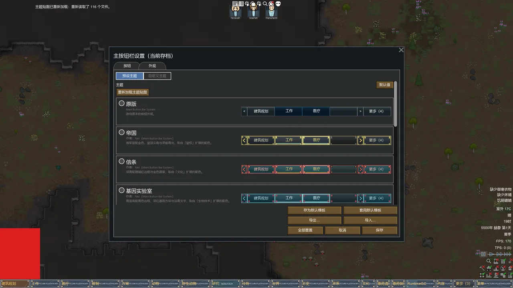

- D5 ✅ 再按兩次仍正常，沒有例外、沒有破圖；換回原圖再按一次，立繪回到原樣。

  
- D6 ✅ 關掉開發模式後外觀分頁沒有這顆按鈕。

  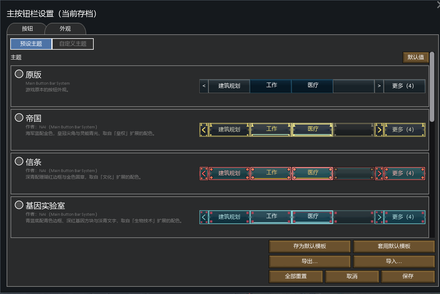

### E. 舊主題與舊存檔

- E1 ✅ 帝國、信條、基因實驗室、虛空、星航各選一次，列正常；「插圖與背景」只顯示「背景不透明度」。

  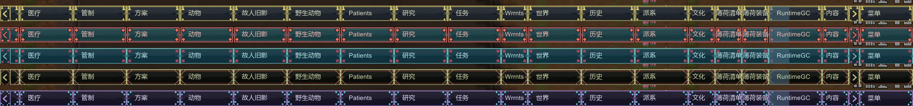

- E2 ✅ 原版：列由遊戲畫，「插圖與背景」只有一行灰字「这个主题没有背景图或装饰图，这里没有可调整的项目。」
- E3 ✅ 讀 `MBBS_round7_test`（1.7.4998 的存檔，設定是基因實驗室、摺疊＋捲動）：外觀照舊，log 只有版本不同的黃字，沒有 `decorationsShown`／`backgroundOpacity` 相關錯誤。

  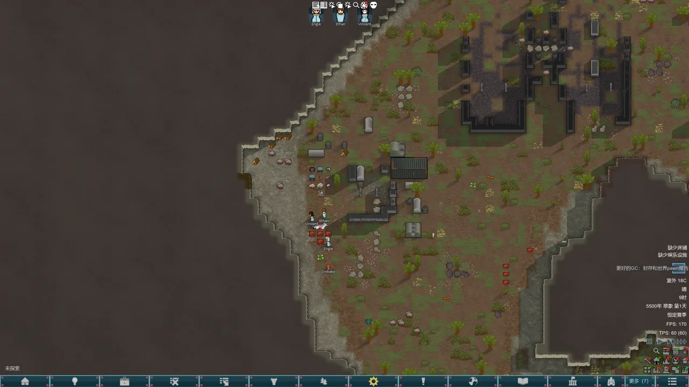

- E4 ✅ 全部重設後選 ExampleTheme 存檔，存檔 XML 的 `MainButtonBarGameComponent` 只有 `displayMode`、`appearance`、`defaultWidth` 等改過的欄位，沒有 `decorationScale`、`backgroundOpacity` 等新欄位。改過的值會寫：範本檔裡有 `decorationScale 150`、`decorationOffsetX 100`。

### G. 工具與範本

- G1 ✅（位元組不同）`make_theme.py tools/themes/ExampleTheme.json docs/examples/ExampleTheme` 之後 `git status` 不乾淨：9 張 PNG 位元組不同、5 個 XML 只差換行（LF／CRLF，`git diff --ignore-cr-at-eol` 是 0 行）。9 張 PNG 用 Pillow 比像素全部相同。本機 Pillow 是 13.0.0，提交版是別的版本產的。
- G2 ✅ `gen_theme_textures.py` 之後 40 個 PNG 位元組不同，像素全部相同。
- G3 ✅ `make_release.py <repo 外資料夾>`：222 個檔案，有 `ThemeTemplate/ExampleTheme`、`ThemeTemplate/tools/make_theme.py`、`API.zh-TW.md`；在 `ThemeTemplate/tools/` 跑 `make_theme.py ExampleTheme.json <資料夾> --textures-only` 產生 16 張貼圖，找得到齒輪來源圖。
- G4 ✅ 把發佈資料夾換進 `Mods\MainButtonBarSystem`（DLL 雜湊和部署版相同）開遊戲：`Themes: 8 theme(s)`，沒有第二張 Example 卡，沒有重複 defName 的錯誤，`ThemeTemplate/` 沒被載入。

### H. 主按鈕背景圖

- H2 ✅（RC）拿掉 `<buttonImage>`：只有建築、研究有圖，其他按鈕只剩框、透出底部列背景。

  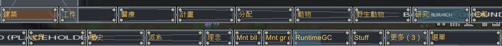

- H4 ✅ 組成商隊進路線規劃後，停用的按鈕仍有按鈕圖（建築棕色、研究藍綠、其他 BUTTON PICTURE）、沒有文字；滑鼠移上的效果只在框上，圖沒有被染色。

  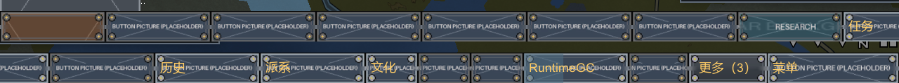

- H5 ✅ 建築 `verticalAnchor` 改 `Bottom`：看到佔位圖的下緣（底邊亮線在、上框被裁掉）。單顆寬 120 的 Top 那一半之前已看過（H1）。
- H6 ✅ 建築 `inset` 改 8：圖和框之間明顯多一圈空隙。
- H7 ✅（RA）`ButtonResearch.png` 改名：主選單一筆 `… buttonImages[1].texture: texture 'ExampleTheme/ButtonResearch' not found (the game's look is used for it)`；研究鈕只剩框（沒有改用預設圖）；之後不再多記；沒有紅字。

  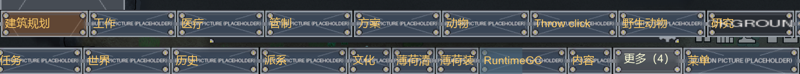

- H9 ⚠️ 只驗一半（RC）：拿掉 `<preview>` 後外觀分頁改用畫出來的預覽，建築那格是自己的棕色圖。因為同一輪也拿掉了預設圖（H2），其他格和停用那格都只剩框，沒辦法確認「停用的那格也有預設圖」。
- H10 ✅ 整條列「只顯示圖示」時圖示畫在按鈕圖上、沒有文字；「圖示＋文字」時兩者都在圖上。
- H12 ✅ 研究 `fit` 改 `Fit`：整張 RESEARCH 都看得到。改 `Stretch`：預設寬度（150）下看起來和 Fit 幾乎一樣（按鈕比例接近圖片的 4:1）；把研究鈕單顆寬度拉到 300 後，圖被拉伸填滿、字被拉寬。

  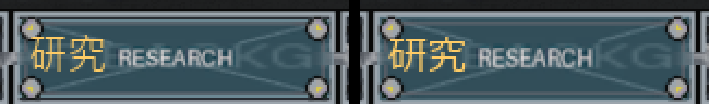
  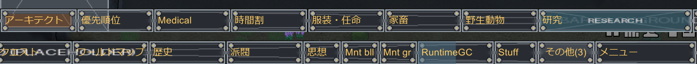

- H13 ✅ `button` 寫 `Achitect`：一筆 `… buttonImages: 1 picture(s) name main buttons that are not loaded (a typo, or a mod that is not active), so they are unused: Achitect`，沒有紅字。
- H14 ✅ 設定錯誤（紅字，預期）：`Config error in ExampleTheme_Steel: buttonImages[2]: button is empty (the defName of a MainButtonDef)`、`Config error in ExampleTheme_Steel: buttonImages[4]: opacity must be between 0 and 1`。

## round-8

1. ✅ 只顯示圖示（有 VTE，最小寬度 150）：沒有文字、圖示置中；沒圖示的按鈕（故人旧影）照常顯示文字。「圖示＋文字」：圖示在左、文字在右，只有一份圖示。「預設」：VTE 的設定檔沒有設定過，預設 `mainButtonMode = IconsAndText`（反編譯確認），這個模式本身就是「有圖示只顯示圖示」，所以「預設」和「只顯示圖示」看起來一樣；清單寫的「VTE 的圖示在左＋文字」是 VTE 選 `IconsThenText` 時的樣子，這次沒有去改 VTE 的設定。

   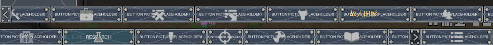
   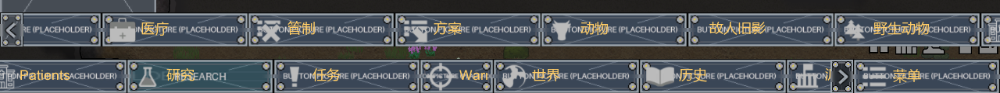

2. ✅（RG，沒有 VTE）只顯示圖示：有圖示的按鈕（醫療、歷史、派系、理念、薄荷選單…）只顯示置中的圖示，原版按鈕沒有圖示所以顯示文字。沒有和改版前的位置逐像素比對。

   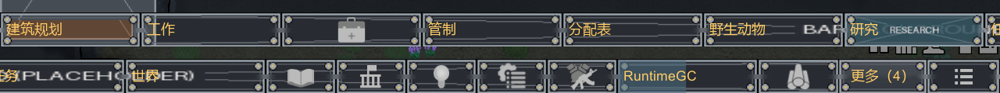

3. ✅ 虛空滑鼠移上：移上那顆的底線亮紅 (231,99,85)、往上幾列也偏紅；旁邊一般狀態的按鈕底部是 (25,17,13)，只有細紅線。

   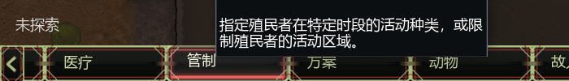

4. ✅ 停用狀態：外觀分頁每款預覽的第 4 顆是停用外觀；世界地圖「组建远行队」進路線規劃後，`validWithoutMap` 為 false 的按鈕和「世界」停用、沒有文字。虛空和 ExampleTheme 各看了一次（ExampleTheme 見 H4）。

   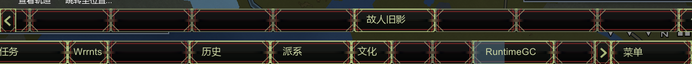

5. ✅ 文字靠左：一般按鈕、「更多」抽屜裡的按鈕、「圖示＋文字」都靠左。

   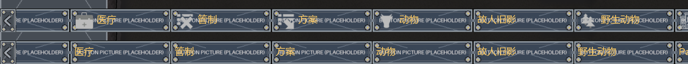
   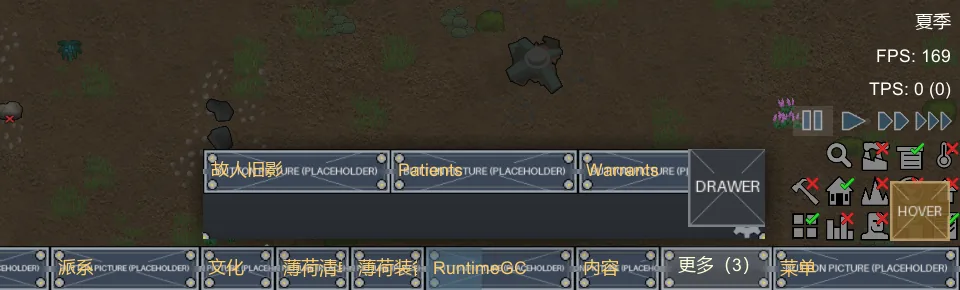

6. ✅ Custom Bottom Bar：設定檔裡原本就是「本模組優先」（第七輪留下的），所以順序反過來測。本模組優先：進地圖 log 有兩行 `Custom Bottom Bar: removed its patch BottomBarSpacing.MainButtons_DoButtons_Patch.Prefix on MainButtonsRoot.DoButtons (this mod has priority).`（另一行是 `MainButtonWorker.DoButton`），列由本模組畫。改成「Custom Bottom Bar 優先」：馬上出現「重新启动游戏后生效。」；重開後 log 沒有移除補丁的訊息，列由 Custom Bottom Bar 照原版畫。

   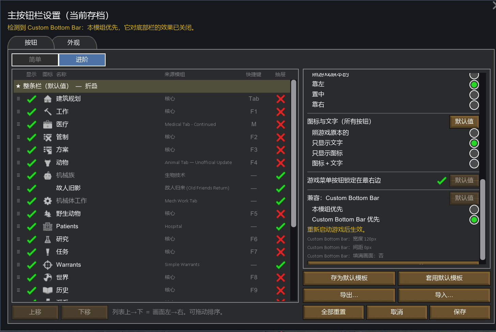
   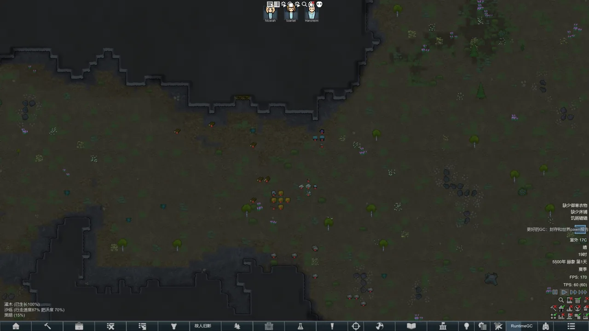

7. ✅（M4 沒測、M8 不符）checklist-stage-4 M 節，用 `Diagnostics/buttons.tsv`：
   - M1 ✅ Architect、Work、Research 等 `iconPath` 空白。
   - M2 ✅ Guests＝Hospitality (Continued)、RPMainButton（Rimpedia）＝Rimpedia 1.7、MintGearMenu＝Dubs Mint Menus。
   - M3 ✅ History、Factions、Menu、Ideos 的 `iconSourceMod` 空白（本體資源）。
   - M4 — RimTalk 系列不能放進測試排序，沒測。
   - M5 ✅ Architect、Work、Schedule、Assign、Animals、Research、Wildlife、Quests、World 都是 Vanilla Textures Expanded；MedicalTab、AIRobots 是 Bradson's。
   - M6 ✅ Guests、RPMainButton、MintGearMenu 換成 Bradson's 的圖。
   - M7 ✅ History、Factions、Menu 的 `minimized` 變 False。
   - M8 ❌ Ideos 的來源仍是本體，不是 Tang's 貼圖重置。原因：Tang's（`TW.Tangs.Retexture.UI`，3141849282）的檔案放在 `Textures/UI/buttons/mainbuttons/Ideoligions.png`，1.7 找貼圖分大小寫，`UI/Buttons/MainButtons/Ideoligions` 對不上，所以實際上沒有蓋過本體。本模組顯示的是對的，是清單的預期要改。
   - M9 ✅ Mechs、SM_MechWork 都是 VTE 的 `IconMechanoids`。
   - M10 ✅ swap 那份只有 Mechs 變成 Bradson's 的 `Mechs`，其他 58 顆和 retexture 相同。
   - M11 ✅ 範本視窗替「訪客」選內建圖示 AlertTab，清單上的圖示換掉；按「預設值」回到 Bradson's 的圖。

     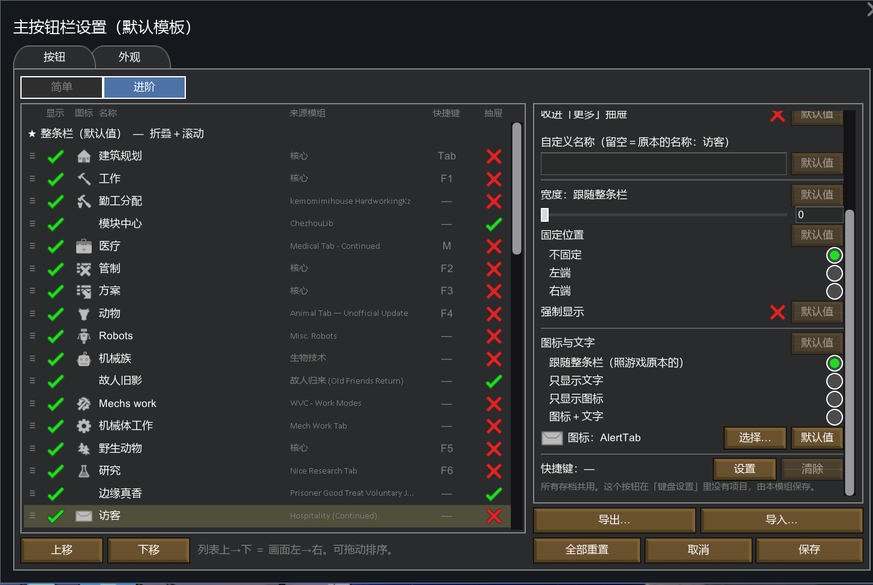
     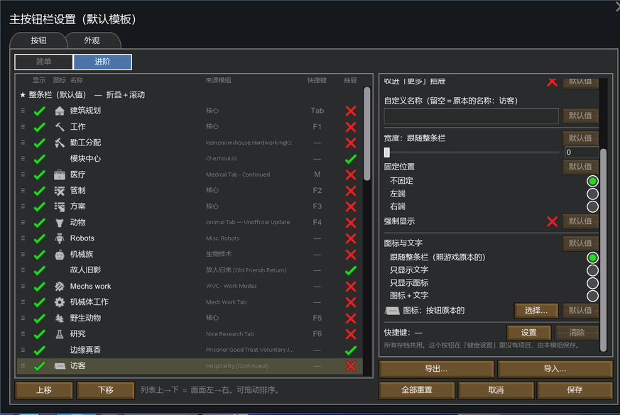

   - M12 — 沒另外做（圖示模式在 round-8 1、2 已測）。
   - M13 ✅ 三份都沒有 `Could not load Texture2D`；本模組只有萘伊那條開發模式黃字。

8. ✅ 每次開發模式啟動，本模組只有萘伊那條黃字（和 RA 刻意製造的那些）；沒有預期外的紅字。

## round-9

### A. 匯出與匯入（S1）

1. ✅ 排法：摺疊、5 顆收進抽屜、「方案」改名「分配表」、隱藏「動物」、「分配表」用匯入的 PNG 圖示 `test_gold_gear_64.png`、主題示例鋼鐵。
2. ✅ 「存成文件」視窗有名稱、作者（預設 `boblin00215`＝Steam 名稱）、說明。存成 `整齐的列.xml`，有 `<meta>`（name、author、description、gameVersion、modVersion `0.9.0`、exported、buttons 59 顆…）和 `<config>`；再存一次變成 `整齐的列 (2).xml`。第二次打開視窗時名稱和說明會帶上次的值。
3. ✅ 匯入選單：「整齐的列，作者 boblin00215（整齐的列.xml）」，最後一項「打开排序文件夹」（沒有按，避免開檔案總管）。
4. ✅ 報告：作者、說明、「制作环境：RimWorld 1.7.5000 rev1275，Main Button Bar System 0.9.0。」、來源、「两边都有的按钮：28 个」，沒有黃字，五個部分都勾選。

   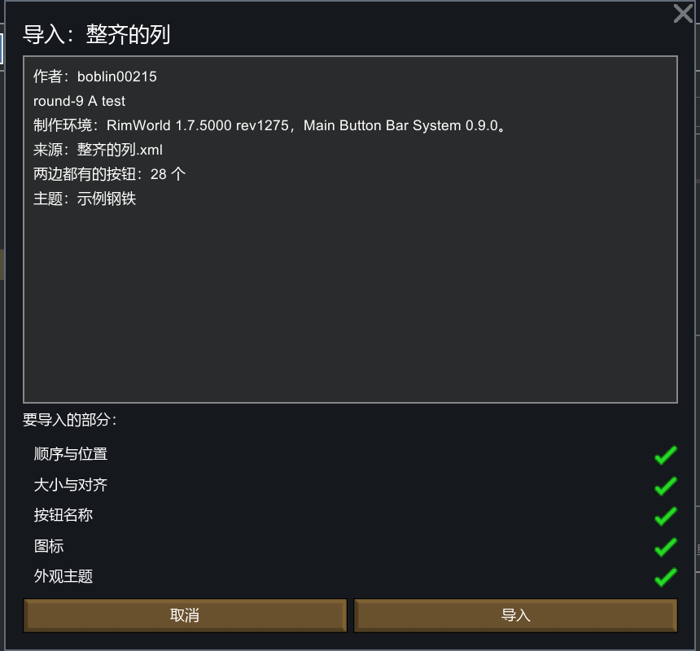

5. ✅ 全部重設後只勾「外观主题」匯入：只有主題變成示例鋼鐵，其他維持重設後的樣子。取消後重開，只勾「按钮名称」：只有「方案」變「分配表」。
6. ✅ 全部勾選匯入：和匯出時一樣；儲存後保留。
7. ✅ 「复制成文字」：剪貼簿內容有 `<meta>`；「从剪贴板」匯入的報告來源是「剪贴板」。

### B. 跨模組清單

1. ✅ 在 M1（buttons_max，74 個）匯出 `max-buttons.xml`（meta 59 顆）。
2. ✅ 到按鈕少的排序（RG）匯入：黃字「你的游戏没有、设置会跳过的按钮：38 个」，下面依模組分組（AAAA、AI 智能漢化網絡、Vanilla Achievements Expanded、ChezhouLib、The Dead Man's Switch…），另有一組「未知模组」（匯出那台遊戲沒載入、只是設定裡留著的按鈕）。匯入後沒有錯誤。

   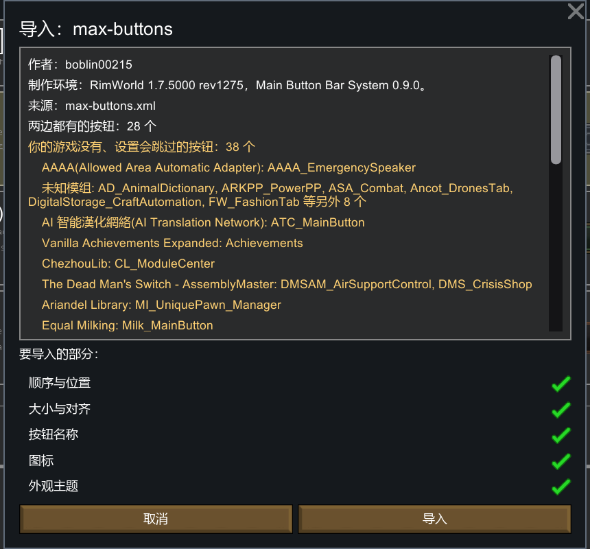

3. ✅ 反過來，在 M1 匯入 `整齐的列.xml`（S1 匯出、51 個模組）：「只有你的游戏有、保留你的设置（新的排在菜单左边）：31 个（警报, Robots, AI 翻译, Achievements, 模块中心, 任务书 等另外 25 个）」。匯入前先隱藏的「炒股」，匯入後仍是隱藏。
4. ✅ 匯入舊檔 `Arrangement_20261104_122609.xml`：「这份排序没有记录制作时的按钮列表（旧版导出）。它没提到的按钮会保留你的设置。」；檔案沒設定的「按钮名称」「外观主题」灰掉不勾，旁邊註明「（这份排序没有设置：导入会把你的恢复默认）」。

   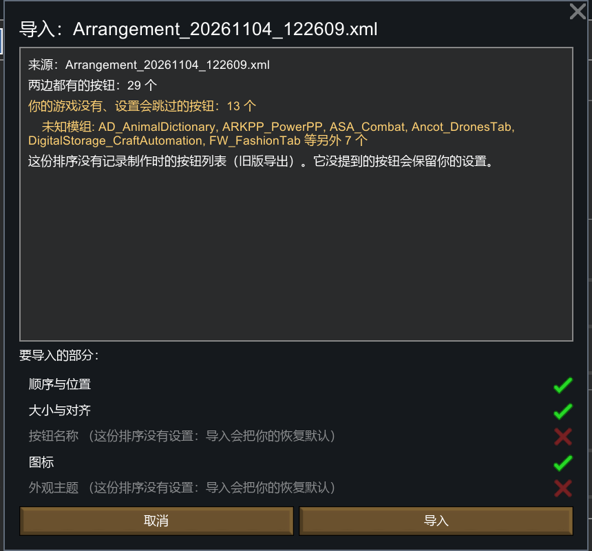

5. ✅ M1 沒有 ExampleTheme：匯入 `整齐的列.xml` 的報告寫「主题 ExampleTheme_Steel（来自 Example Theme for Main Button Bar System）未安装；装好之前会使用原版外观。」，同時列出缺少的匯入圖示。

   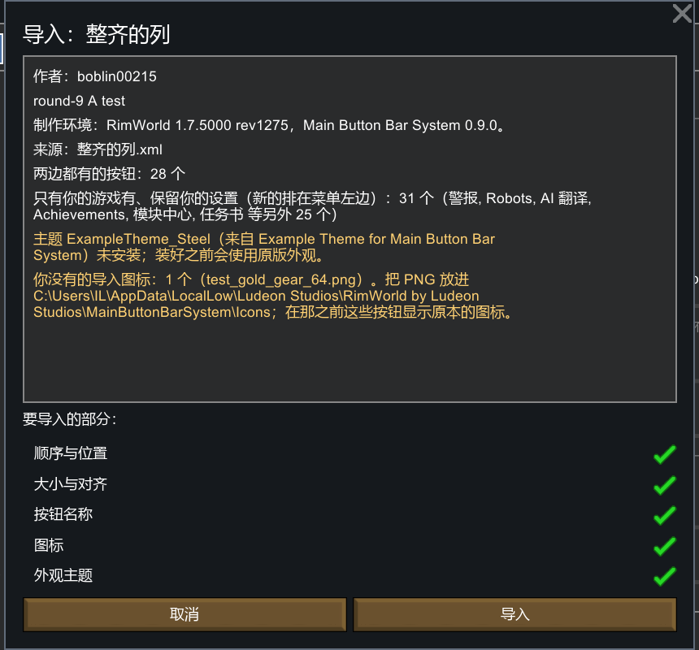

### C. 做成排序模組

1. ✅ 名稱「整齐的列」、作者 `boblin00215`，Package ID 自動填 `Boblin00215.Arrangement11061811`。改成 `bad id`：出現格式說明、「创建」變灰；改成 `NAI.MainButtonBarSystem`：「NAI.MainButtonBarSystem 已被其他模组使用。」、「创建」變灰。

   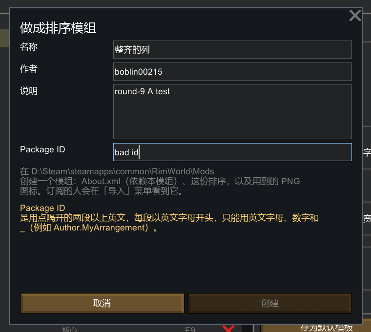

2. ✅ 用 `Boblin00215.ArrangementR89Test` 建立：訊息寫出資料夾 `D:\Steam\steamapps\common\RimWorld\Mods\整齐的列`，有「打开文件夹」。內容：`About/About.xml`（名稱、作者、packageId、支援 1.7、相依本模組、loadAfter、說明附一句用法）、`Defs/MainButtonArrangement.xml`、`Defs/MainButtonIcons.xml`、`Textures/Boblin00215ArrangementR89Test/Icons/TestGoldGear64.png`，排序裡的圖示路徑指向 `Boblin00215ArrangementR89Test/Icons/TestGoldGear64`。
3. ✅（RA）啟用這個模組：0 錯誤（黃字見「發現的問題」2）；匯入選單出現「排序积木：整齐的列（boblin00215）」；把 `Icons` 資料夾的原檔移開後匯入，「分配表」的金色齒輪照常顯示。

   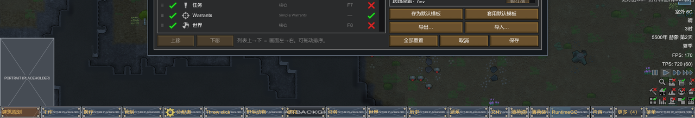
4. — 上傳工作坊（選做）沒做。

### D. 範例模組

1. ✅（RG）本模組＋兩個範例：0 錯誤；`Themes: 10 theme(s)`；外觀分頁有「Leaf folk (example)」（作者行 NAI（MBBS Example: Soft Race Mod））、「Ember (example)」（MBBS Example: Theme Pack）；匯入選單有「排序积木：Leaf folk layout (example)（NAI）」；摺疊模式下 Leaf folk 一開始在抽屜裡、顯示圖示＋文字。圖示選擇器的內建頁沒有另外截圖確認兩個葉子圖示。

   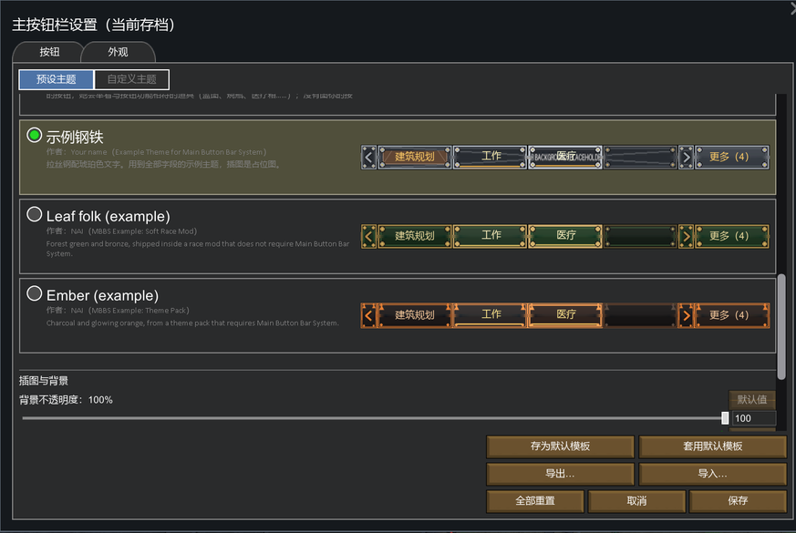
   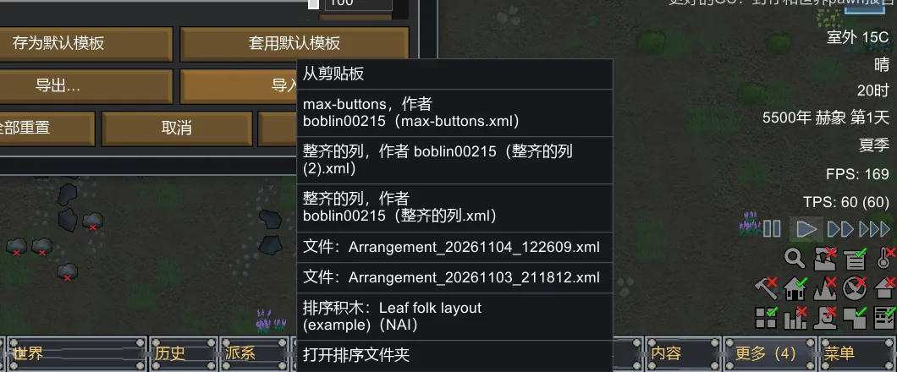
   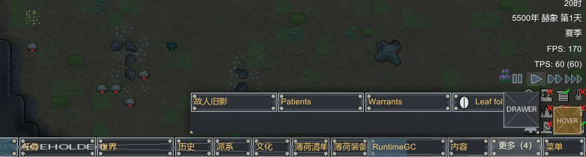

2. ✅（RH）只啟用 SoftRace、沒有本模組：載入 0 錯誤，沒有 `Could not find type` 或 MayRequire 相關訊息；讀檔後 Leaf folk（葉子圖示）出現在原版列上。讀檔時有 2 筆紅字 `Could not find class MainButtonBarSystem.MainButtonBarGameComponent …`，是因為存檔是有本模組時存的，和 SoftRace 無關。

   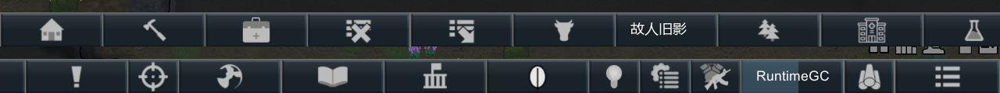

3. ✅（只做靜態檢查）只啟用 ThemePack、沒有本模組：check_order 報「缺硬性前置：MBBS Example: Theme Pack 需要 Main Button Bar System」。沒有進遊戲看模組清單的提示。

### E. 其他

1. ✅ 剪貼簿是 `<config Class="MainButtonBarSystem.MainButtonBarConfig">…` 的文字，從剪貼簿匯入：被擋下，訊息「这段文字要求建立程序类别，排法不需要这个，所以没有导入。」，log 沒有東西。
2. ✅（RD）日文：「ファイルに保存」視窗、匯出選單、匯入選單、匯入報告都沒有字擠出框外；長的選單項目（「配置MODを作成(そのままアップロード可能)」）換行。作者名在日文裡首字母變大寫，見「發現的問題」3。

   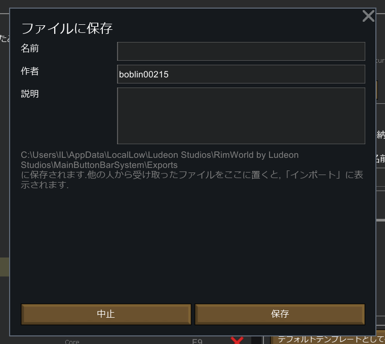
   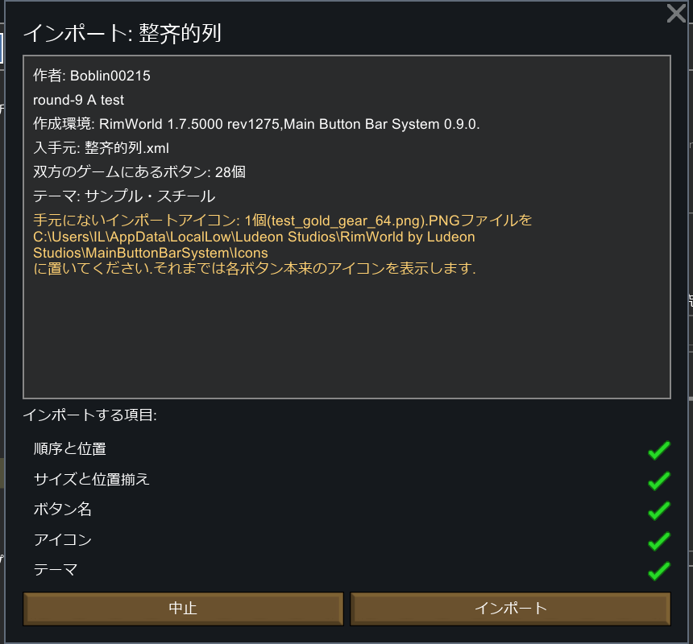

3. ✅ 每次開發模式啟動的本模組紅字黃字都在各節寫了；預期外的只有 round-10 B.3 那一筆。

## round-10

### B.3 例外防護 ⚠️

測試用小模組加兩顆主按鈕：`R10_ThrowOnDraw`（`DoButton` 直接丟例外）、`R10_ThrowOnClick`（`Activate` 丟例外）。

- 放在主列：進地圖時一筆 `Main button R10_ThrowOnDraw (from [TEST] MBBS round-10 throw buttons) threw while being drawn; the rest of the bar keeps working.`；其他按鈕照常、可以點，列仍由本模組畫（主題、順序都在）。**但之後第一次在列附近點滑鼠時，同一顆又記了一筆 `… threw while handling input …`**，所以這顆總共兩筆紅字，清單預期只有一筆。之後不再增加。
- 收進抽屜再打開抽屜：那一格空著、其他格正常，沒有新的紅字。

  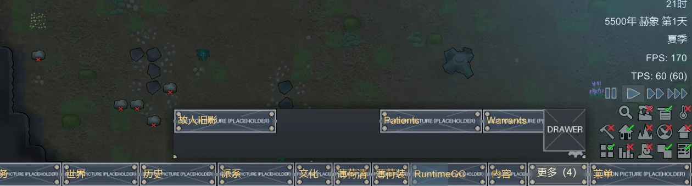

- 點 `R10_ThrowOnClick`：一筆 `Main button R10_ThrowOnClick (…) threw while handling input; the rest of the bar keeps working. System.Exception: test click`，列不會變原版、主題還在。

### B.4 Tuning 少了 behaviour ✅

XML 補丁 `PatchOperationRemove` 刪掉 `MainButtonBarTuning/behaviour`：

- 啟動：`Config error in MainButtonBarTuning: behaviour is missing`（紅字，預期）。主選單正常。
- 進地圖：一筆 `[Main Button Bar System] Drawing the main button bar failed; handing it back to the game for this session. System.NullReferenceException …`（加一行 INFO `The query API is not updated after the failure above`），之後不再刷。列由遊戲照原版畫，警報、視窗、「工作」分頁都正常。

  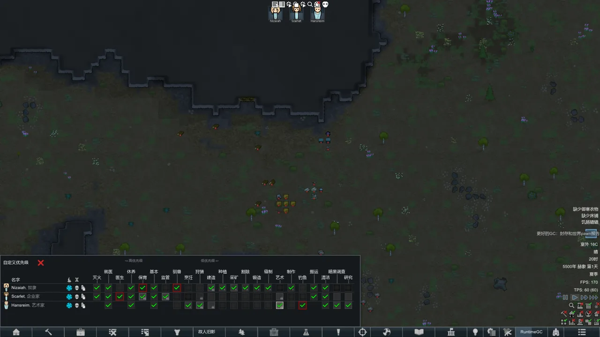

### E.3 — 沒有 DragReorder，跳過。

## 發現的問題

1. **round-10 B.3：畫的時候丟例外的按鈕記兩筆紅字**（一筆 being drawn、一筆 handling input）。推定：例外防護依「畫」和「處理輸入」分開記一次，而 `DoButton` 在 Repaint 和滑鼠事件都會被呼叫。影響小（只多一筆），要不要合併成「每顆按鈕一筆」請決定。
2. **「做成排序模組」產生的 About.xml，相依項沒有 `downloadUrl`／`steamWorkshopUrl`**：每次啟動遊戲都有一行黃字 `Mod 整齐的列 dependency (NAI.MainButtonBarSystem) needs to have <downloadUrl> and/or <steamWorkshopUrl> specified.`（開發模式關也有）。`examples/MBBS_Example_ThemePack` 的 About 也一樣。修法：在 `modDependencies` 的本模組那項加 `steamWorkshopUrl`（工作坊 ID 確定後）或 `downloadUrl`（GitHub 頁面）。
3. **日文介面把作者名首字母變大寫**：匯入選單「整齐的列(作者: Boblin00215,整齐的列.xml)」、報告「作者: Boblin00215」；簡中是 `boblin00215`。原因沒查（推定是日文翻譯或格式化時對參數做了 CapitalizeFirst）。
4. 小事：設定檔的「总是由本模组绘制底部栏（测试用）」在開發模式關掉時也顯示。不確定是不是刻意的。

## 清單要更新的地方

- theme-addons A2：小排序會多一條萘伊的 `buttonImages` 提示，預期改成「ExampleTheme 0 警告」。
- theme-addons H12：Stretch 要先把研究鈕拉寬才看得出差別。
- round-8 步驟 1：「改回預設」的預期要看 VTE 的設定（預設 `IconsAndText` 是只顯示圖示）。
- checklist-stage-4 M8：Tang's 的貼圖路徑大小寫對不上，1.7 實際不會蓋過本體；M4 需要 RimTalk，測試排序不能放。

## 測試留下的東西、還原

- 設定檔（Prefs、KeyPrefs、本模組設定、範本、VTE 設定）都還原成測試前的備份，雜湊相符。`ModsConfig.xml` 沒動，要用 RimCrow 換回完整清單。
- `Mods\MainButtonBarSystem` 放回部署版（main @ `36d9333`）；`Mods\ExampleTheme` 清空（測試前就是空資料夾）；兩個範例模組、排序模組、兩個測試用小模組都已移走（排序模組留一份在本機測試資料夾）。
- 匯出資料夾裡這次產生的三個檔案移到本機測試資料夾；移開的 `test_gold_gear_64.png` 已放回 `Icons`。
- 存檔：新增 `MBBS_r89a_test`。測試局的自動存檔蓋掉了 `Autosave-2`～`Autosave-5`（遊戲自動存檔上限 5 個、間隔 0.125 天）；`Autosave-1`（使用者 11-06 01:21 的存檔）在被蓋掉前已備份，測完已放回。
